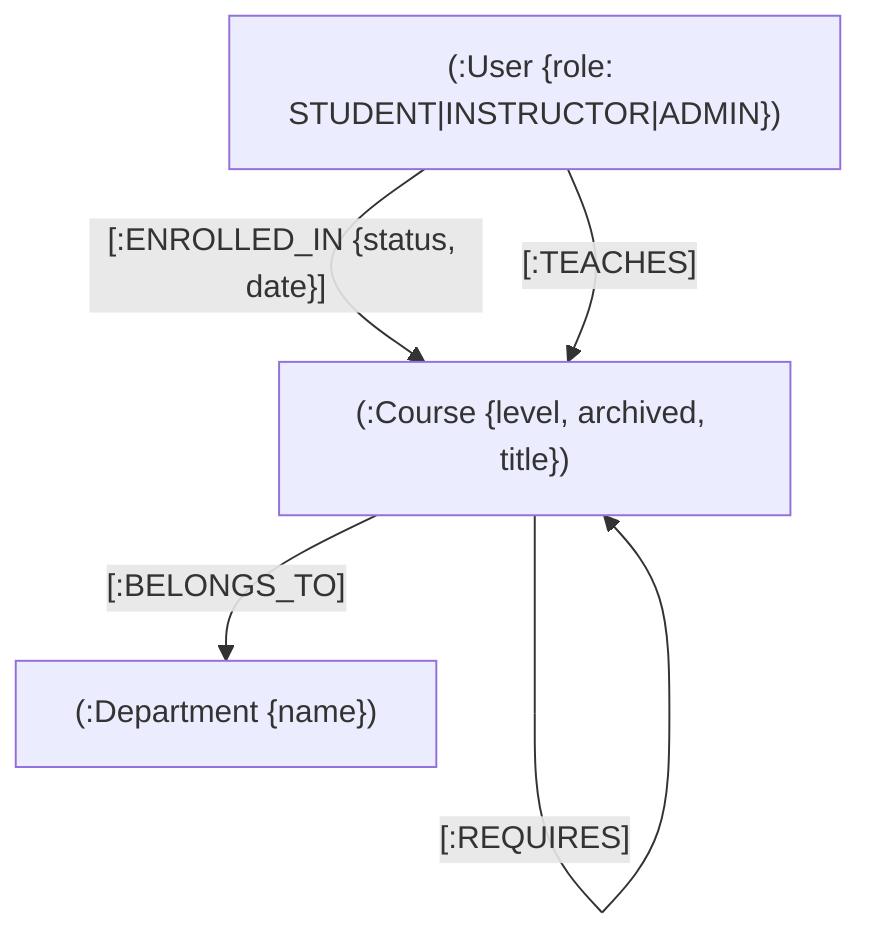

# 🎓 GraphEdu - Backend API (Spring Boot & Neo4j)

[](https://spring.io/projects/spring-boot)
[](https://neo4j.com/)
[](https://graphql.org/)
[](https://www.oracle.com/java/)
[](https://jwt.io/)

> **GraphEdu API** est le moteur backend de la plateforme éducative GraphEdu, conçu sur une architecture orientée graphe avec **Neo4j** et exposé via une API **GraphQL** sécurisée sous **Spring Boot 4**.

---

## 📑 Table des Matières

- [Aperçu du Projet](#-aperçu-du-projet)
- [Modèle de Données Graphe](#-modèle-de-données-graphe)
- [Fonctionnalités Principales](#-fonctionnalités-principales)
- [Algorithmes de Graphe Implémentés](#-algorithmes-de-graphe-implémentés)
- [Architecture & Stack Technique](#-architecture--stack-technique)
- [Prérequis](#-prérequis)
- [Installation & Démarrage](#-installation--démarrage)
- [Documentation de l'API GraphQL](#-documentation-de-lapi-graphql)
- [Configuration de Sécurité (RBAC)](#-configuration-de-sécurité-rbac)
- [Structure du Projet](#-structure-du-projet)

---

## 🌟 Aperçu du Projet

Contrairement aux systèmes de gestion d'apprentissage (LMS) traditionnels basés sur des bases relationnelles SQL, **GraphEdu** modélise les interactions académiques comme un réseau interconnecté (graphe). Cela permet :
- La gestion dynamique et non linéaire des **dépendances et prérequis de cours**.
- Le calcul de trajectoires d'apprentissage optimales via des algorithmes de **plus court chemin (Shortest Path)**.
- Un système de **recommandation collaborative** analysant la proximité entre parcours étudiants.
- Des requêtes de reporting analytique rapides (charge enseignante, progression départementale).

---

## 🕸️ Modèle de Données Graphe



### Nœuds et Relations :
- `(:User)` : Représente les utilisateurs (Étudiants, Enseignants, Administrateurs).
- `(:Course)` : Représente les cours proposés avec niveau de difficulté.
- `(:Department)` : Département académique de rattachement.
- `[:REQUIRES]` : Relation orientée définissant un prérequis obligatoire entre deux cours.
- `[:ENROLLED_IN]` : Relation avec propriétés (`status: IN_PROGRESS | VALIDATED`, `date`).
- `[:TEACHES]` : Association d'un enseignant à son cours.
- `[:BELONGS_TO]` : Rattachement d'un cours à un département.

---

## 🚀 Fonctionnalités Principales

### 👨‍🎓 Espace Étudiant
- **Catalogue filtrable** : Recherche multicritère (département, professeur, niveau de difficulté).
- **Contrôle strict des inscriptions** : Vérification automatique via Cypher des prérequis validés avant confirmation d'inscription.
- **Parcours Académique** : Vue en temps réel des cours validés vs cours restants par département.
- **Recommandations Intelligentes** : Suggestions de cours basées sur les cohortes d'étudiants ayant des parcours similaires.

### 👨‍🏫 Espace Enseignant
- **Gestion des cours** : Création, modification, archivage et association aux départements.
- **Gestion des dépendances** : Liaison de prérequis entre cours existants avec détection de cycles.
- **Suivi des effectifs** : Consultation de la liste des étudiants inscrits par cours.

### 🛡️ Espace Administrateur
- **Gestion des profils** : Listing filtré par rôle, mise à jour et suppression d'utilisateurs.
- **Tableau de bord de charge d'enseignement** : Calcul analytique agrégé du nombre de cours assignés par enseignant.

---

## 🧠 Algorithmes de Graphe Implémentés

### 1. Chemin le Plus Court (Shortest Path vers Certification)
Calcul du parcours de cours minimal pour atteindre un objectif pédagogique ou une certification :
```cypher
MATCH (start:Course), (target:Course)
WHERE id(start) = $startCourseId AND id(target) = $targetCourseId
MATCH p = shortestPath((start)-[:REQUIRES*]->(target))
UNWIND nodes(p) AS c
RETURN c
```

### 2. Filtrage Collaboratif (Recommandation de Cours)
Découverte de cours basée sur le comportement des pairs inscrits aux mêmes cours :
```cypher
MATCH (u:User)-[:ENROLLED_IN]->(c:Course)<-[:ENROLLED_IN]-(peer:User)-[:ENROLLED_IN]->(reco:Course)
WHERE id(u) = $studentId
  AND NOT (u)-[:ENROLLED_IN]->(reco)
  AND reco.archived = false
WITH reco, COUNT(peer) AS score
ORDER BY score DESC LIMIT 5
RETURN reco
```

### 3. Contrôle des Prérequis Manquants
Vérification d'absence de prérequis non validés avant inscription :
```cypher
MATCH (target:Course)-[:REQUIRES]->(prereq:Course)
WHERE id(target) = $courseId
  AND NOT EXISTS {
    MATCH (s:User)-[e:ENROLLED_IN]->(prereq)
    WHERE id(s) = $studentId AND e.status = 'VALIDATED'
  }
RETURN prereq
```

---

## 🛠️ Architecture & Stack Technique

- **Framework** : Spring Boot 4.1.1
- **Langage** : Java 17
- **Base de données** : Neo4j (via Spring Data Neo4j + Cypher + Neo4jClient)
- **API** : Spring for GraphQL (Schema-First) + Netflix DGS Codegen
- **Sécurité** : Spring Security 6, JWT (JSON Web Token) stateless
- **Utilitaires** : Lombok, Maven Wrapper

---

## 📋 Prérequis

- [Java JDK 17+](https://adoptium.net/)
- [Neo4j Desktop](https://neo4j.com/download/) ou instance Neo4j locale/Docker
- [Maven 3.8+](https://maven.apache.org/) (ou utiliser le `./mvnw` inclus)

---

## ⚙️ Installation & Démarrage

### 1. Configuration de Neo4j
Lancez votre base de données Neo4j locale (par exemple via Neo4j Desktop).
Vérifiez ou adaptez les accès dans `src/main/resources/application.properties` :

```properties
spring.application.name=GraphEdu-project

# Connexion Neo4j
spring.neo4j.uri=bolt://localhost:7687
spring.neo4j.authentication.username=neo4j
spring.neo4j.authentication.password=votre_mot_de_passe

# GraphiQL Playground
spring.graphql.graphiql.enabled=true
spring.graphql.graphiql.path=/graphiql
```

### 2. Compilation et Lancement

```bash
# Avec le wrapper Maven (Windows PowerShell / CMD)
.\mvnw.cmd spring-boot:run

# Sur Linux / macOS
./mvnw spring-boot:run
```

Le serveur démarre sur `http://localhost:8080`.
L'interface de test interactive **GraphiQL** est accessible sur : `http://localhost:8080/graphiql`.

---

## 📡 Documentation de l'API GraphQL

### Point d'entrée :
- **Endpoint HTTP** : `POST http://localhost:8080/graphql`
- **Header d'authentification** : `Authorization: Bearer <votre_token_jwt>`

### Exemples d'opérations :

#### Inscription & Authentification
```graphql
mutation Register {
  register(email: "student@test.com", password: "password123", name: "Alice", role: "STUDENT") {
    token
    user {
      id
      email
      name
      role
    }
  }
}

mutation Login {
  login(email: "student@test.com", password: "password123") {
    token
    user {
      id
      name
      role
    }
  }
}
```

#### Simulation du Plus Court Chemin
```graphql
query SimulatePath {
  getShortestCertificationPath(startCourseId: "1", targetCourseId: "5") {
    startCourseId
    targetCourseId
    pathLength
    pathCourses {
      id
      title
      level
    }
  }
}
```

#### Recommandations Étudiant
```graphql
query Recommendations {
  getCourseRecommendations(studentId: "1") {
    id
    title
    level
  }
}
```

#### Rapport de Charge Enseignante (Admin)
```graphql
query TeachingLoad {
  getTeachingLoadReport {
    professorName
    professorEmail
    courseCount
  }
}
```

---

## 🔒 Configuration de Sécurité (RBAC)

L'authentification s'effectue via token **JWT**. Les routes et résolveurs GraphQL sont protégés selon les rôles :
- `STUDENT` : Inscription aux cours, consultation de son parcours, recommandations, simulateur.
- `INSTRUCTOR` : Création et mise à jour de ses cours, ajout de prérequis, consultation des étudiants inscrits.
- `ADMIN` : Accès aux statistiques globales, charge horaire, gestion et suppression d'utilisateurs.

---

## 📂 Structure du Projet

```
src/main/
├── java/com/example/graphedu/
│   ├── config/          # Gestion globale des erreurs GraphQL
│   ├── controller/      # Résolveurs GraphQL (Queries & Mutations)
│   ├── dto/             # Objets de transfert de données
│   ├── model/           # Entités Nœuds & Relations Neo4j (SDN)
│   ├── repository/      # Interfaces Neo4jRepository avec requêtes Cypher
│   ├── security/        # Filtre JWT, UserDetailsService, SecurityConfig
│   └── service/         # Logique métier & implémentations
└── resources/
    ├── application.properties
    └── graphql/
        └── schema.graphqls  # Définition formelle du schéma GraphQL
```

---

## 👨‍💻 Auteur

Développé par **Achraf Benagri** ([@achraal](https://github.com/achraal)).
