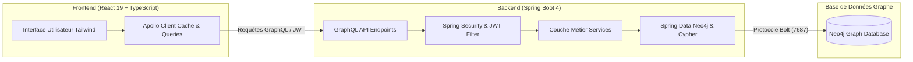

# 🎓 Sapientia - Plateforme Académique Intelligente Orientée Graphe

[](https://neo4j.com/)
[](https://spring.io/projects/spring-boot)
[](https://graphql.org/)
[](https://react.dev/)
[](https://www.typescriptlang.org/)
[](https://tailwindcss.com/)

> **Sapientia** est une plateforme éducative moderne tirant parti de la puissance des **bases de données orientées graphe (Neo4j)** et de **GraphQL** pour orchestrer la gestion académique : cartographie des cours, validation intelligente des prérequis, calcul du chemin optimal de certification et recommandations personnalisées par filtrage collaboratif.

---

## 🏗️ Architecture Globale

Le projet est conçu sous une architecture découplée **Full-Stack** :



---

## 📦 Organisation du Répertoire

```
Sapientia/
├── Sapientia-project/       # Backend : API Spring Boot 4, Neo4j, GraphQL, JWT
│   ├── src/
│   ├── pom.xml
│   └── README.md
│
├── Sapientia-frontend/      # Frontend : SPA React 19, TypeScript, Apollo, Tailwind
│   ├── src/
│   ├── package.json
│   └── README.md
│
└── README.md               # Documentation générale du projet
```

---

## ⚡ Fonctionnalités Clés

| Rôle | Fonctionnalités Disponibles |
| :--- | :--- |
| 🧑‍🎓 **Étudiant** | • Exploration du catalogue de cours filtrable par département, niveau et enseignant.<br>• Inscription conditionnelle avec validation stricte des prérequis par le graphe.<br>• Suivi visuel du cursus : cours validés vs cours restants.<br>• Recommandations intelligentes par filtrage collaboratif (basées sur les pairs).<br>• Simulateur du plus court chemin vers une certification. |
| 👨‍🏫 **Enseignant** | • Création et mise à jour des cours.<br>• Configuration des relations de dépendance et prérequis entre modules.<br>• Suivi des étudiants inscrits à ses formations.<br>• Archivage de cours. |
| 🛡️ **Administrateur** | • Gestion centralisée des utilisateurs (Étudiants, Enseignants, Administrateurs).<br>• Tableau de bord analytique de la charge d'enseignement des professeurs. |

---

## 🧠 Puissance du Moteur de Graphe (Neo4j)

Sapientia exploite la théorie des graphes pour résoudre des problématiques complexes :

1. **Shortest Path (Chemin Optimal)** : Utilise l'algorithme natif `shortestPath()` de Cypher pour identifier la séquence de cours la plus rapide afin d'atteindre un module cible ou une certification.
2. **Filtrage Collaboratif** : Analyse les traversées de graphe `(Étudiant)-[:ENROLLED_IN]->(Cours)<-[:ENROLLED_IN]-(Pair)-[:ENROLLED_IN]->(Candidat)` pour suggérer les cours les plus populaires au sein d'une cohorte similaire.
3. **Validation Anti-Blocage** : Analyse en profondeur les relations `[:REQUIRES]` avant d'autoriser toute nouvelle inscription.

---

## 🚀 Démarrage Rapide

### 1. Prérequis
- **Java** JDK 17+
- **Node.js** v18+ & npm
- **Neo4j Desktop** ou instance Neo4j locale active sur le port `7687`

---

### 2. Démarrer le Backend

1. Rendez-vous dans le dossier backend :
   ```bash
   cd Sapientia-project
   ```
2. Configurez vos identifiants Neo4j dans `src/main/resources/application.properties` :
   ```properties
   spring.neo4j.uri=bolt://localhost:7687
   spring.neo4j.authentication.username=neo4j
   spring.neo4j.authentication.password=votre_mot_de_passe
   ```
3. Lancez l'application :
   ```bash
   # Windows
   .\mvnw.cmd spring-boot:run
   
   # Linux / macOS
   ./mvnw spring-boot:run
   ```
4. L'API GraphQL est disponible sur `http://localhost:8080/graphql` et la console interactive GraphiQL sur `http://localhost:8080/graphiql`.

---

### 3. Démarrer le Frontend

1. Rendez-vous dans le dossier frontend :
   ```bash
   cd Sapientia-frontend
   ```
2. Installez les dépendances :
   ```bash
   npm install
   ```
3. Lancez le serveur de développement :
   ```bash
   npm run dev
   ```
4. Ouvrez votre navigateur sur `http://localhost:5173`.

---

## 🛠️ Stack Technologique

- **Backend** : Spring Boot 4.1.1, Spring Data Neo4j, Spring GraphQL, Spring Security, JJWT, Java 17
- **Base de Données** : Neo4j (Cypher Query Language)
- **Frontend** : React 19, TypeScript, Apollo Client, Vite, Tailwind CSS, Lucide React
- **Routage & Sécurité** : React Router DOM 7, RBAC (Role-Based Access Control)

---

## 📄 Licence & Contact

Développé par **Achraf Benagri** ([@achraal](https://github.com/achraal)).
Ce projet est disponible sous licence open-source.
